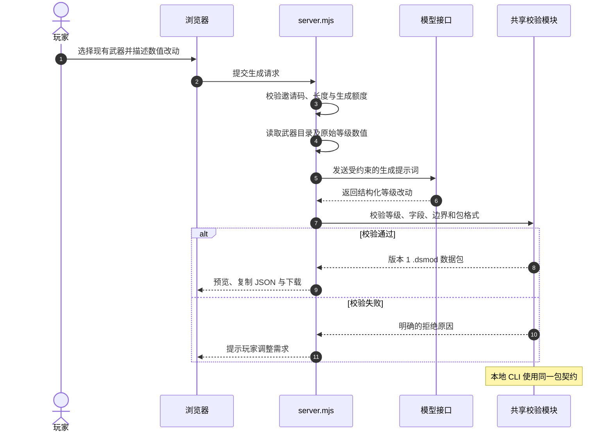
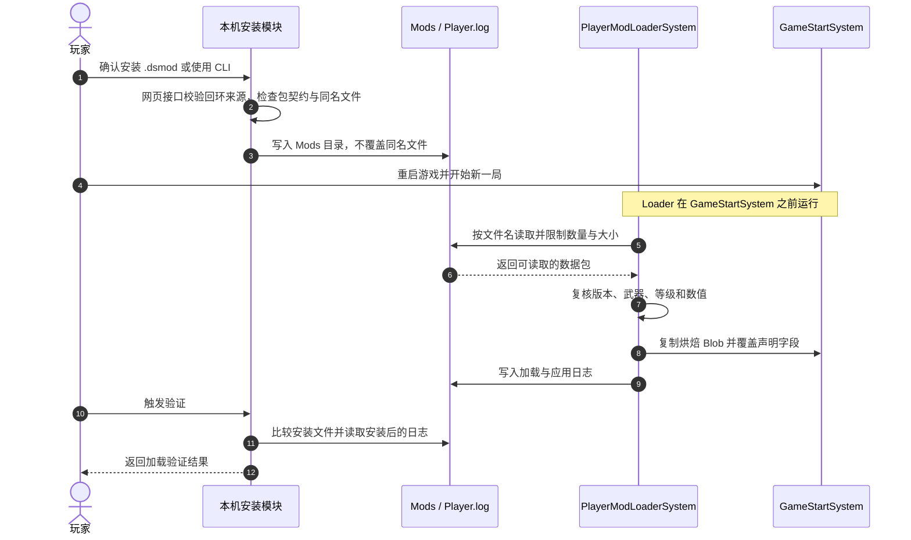

# DOTS Survivors 玩家模组生成器

这是一个面向《DOTS Survivors》Windows 版本封闭测试玩家的网页工具。玩家用自然语言描述武器平衡调整，服务端调用兼容 OpenAI Chat Completions 的模型，校验生成结果并提供 `.dsmod` 文件下载。模组只包含数据，不包含脚本或可执行内容。

## 功能

- 通过邀请码进入封闭测试界面，支持简体中文和英文。
- 为现有武器的各个等级生成基础伤害、冷却时间调整；黑洞武器仅支持调整冷却时间。
- 生成前在服务端校验武器、等级和数值范围，网页提供结果预览、JSON 复制和 `.dsmod` 下载。
- 按 IP 限制每小时生成次数，并限制全站每日生成次数。
- 模型密钥只由服务端读取；模型接口由环境变量配置。
- 提供本地 CLI 与仓库内 Agent 技能，支持生成、校验、安装 `.dsmod`，并根据 Unity 日志检查是否加载。
- 网页可导入 CLI 创建的 `.dsmod`；在本机打开网页时，还可校验、安装和检查游戏日志。网页与 CLI 共用相同的本地操作模块，并保留文件原文以便交叉验证。

## 系统架构

**生成 `.dsmod` 数据包**



**安装、游戏加载与验证**



网页服务使用 Node.js 内置模块提供静态文件、生成接口与本机模组接口。CLI 与网页共用武器目录、数据包校验、安装与日志检查。只有服务监听本机回环地址时，本机操作接口才可用；网页不会自动安装，须由玩家点击安装。游戏日志用于确认加载状态，游戏内效果通过实机数值检查确认。接口和限制见 [网页与 CLI 互通说明](docs/web-cli.md)。

### 从自然语言到游戏生效

1. 玩家选择现有武器并描述改动，`server.mjs` 先校验邀请码、请求长度和额度，再把武器目录中的原始等级数值放进模型提示词。兼容 OpenAI 的模型接口返回结构化等级改动；服务端用 `level-validation.mjs` 和 `package-contract.mjs` 再校验一次，生成版本 1 的 `.dsmod` 数据包。
2. 网页展示改动并提供下载。本地 Agent/CLI 可以直接从明确的数值调用同一套武器目录和包校验模块，因此网页生成的文件与 CLI 创建的文件采用同一契约。模型只负责提出数据，最终数据包仍由确定性的校验逻辑约束。
3. 玩家手动安装或在本机界面确认安装后，`local-mod-workflow.mjs` 将文件写入游戏 `Mods` 目录；同名文件拒绝覆盖。本机安装与日志接口只对回环地址开放，并检查请求来源。CLI `verify` 比较安装文件原文，再检查晚于安装时间的 `Player.log` 加载和补丁消息。
4. Unity 端的 `PlayerModLoaderSystem` 在 `GameStartSystem` 前读取包，校验游戏 ID、版本、武器、等级和数值。它以烘焙的升级数据为基线，复制 Blob 后只覆盖声明的伤害或冷却字段；移除模组后下一局可回到原值。同一字段有多个包时按文件名顺序应用，后面的包覆盖前面的值。

### 契约与信任边界

`.dsmod` 只包含现有武器的数值变更，不允许脚本、程序集或资源。Node.js 和 Unity 两侧都限制版本与取值范围；黑洞武器只允许修改冷却。游戏端最多读取顶层 50 个文件、每个 64 KiB，发现无效包时跳过并写日志。数据包合法、安装成功、日志确认加载和游戏内数值生效分别是四个检查点；代码入口见 [`package-contract.mjs`](package-contract.mjs)、[`local-mod-workflow.mjs`](local-mod-workflow.mjs) 和 Unity 游戏工程中的 `PlayerModLoaderSystem.cs`。

## 技术栈

| 部分 | 技术 | 用途 |
| --- | --- | --- |
| 页面 | HTML、CSS、原生 JavaScript | 表单、双语界面、结果预览、文件导入与本机操作 |
| 服务端 | Node.js 20+、内置 `node:http`、`fetch` | 静态资源、生成接口、本机接口、模型请求与限流 |
| 本地工具 | Node.js CLI、仓库内 Agent 技能 | 按明确数值生成，调用共享模块校验、安装并检查日志 |
| 模型接口 | OpenAI 兼容的 Chat Completions API | 将玩家描述转换为结构化调整数据 |
| 模组格式 | JSON、`.dsmod` 扩展名 | 与 Unity 加载器共享的数据包契约 |
| 校验 | Node.js 内置测试运行器 | 校验等级、数值边界及网页与 CLI 往返流程 |

项目没有第三方 npm 运行时依赖，无需执行 `npm install`。

## 本地 Agent 与 CLI

在项目根目录运行 `npm run mod -- catalog` 查看现有武器。下面的命令会创建并自动校验一个只调整圆锯第 1 级的模组：

```powershell
npm run mod -- create --weapon SawBlade --title "Faster Buzz Saw" --id faster-buzz-saw --set "1:damage=28,cooldown=2.4" --out .\faster-buzz-saw.dsmod
```

`npm run mod -- validate .\faster-buzz-saw.dsmod` 可再次校验。安装与日志检查的用法见 [本地 CLI 文档](docs/cli.md)。仓库内的 [Agent 技能](.agents/skills/dots-survivors-local-modder/SKILL.md) 让支持技能的编程代理根据玩家描述调用这些工具。CLI 本身不调用模型，具体改动值由玩家或代理确认。

开发者还可运行 `npm run catalog:check -- "D:\Unity Space\Survivor"`，检查当前武器目录是否与 Unity 的升级资源一致。

## 本地运行

需要 Node.js 20 或更新版本。在项目根目录使用 PowerShell；已有 `.env` 时保留现有文件：

```powershell
if (-not (Test-Path .env)) { Copy-Item .env.example .env }
```

编辑 `.env`，填写测试邀请码、模型 API 密钥和模型名称，然后启动：

```powershell
npm start
```

在浏览器打开 <http://127.0.0.1:4173/>。`npm start` 已在 Node.js v24.18.0 环境验证可启动；访问地址和端口可通过 `HOST`、`PORT` 调整。

| 环境变量 | 默认值 | 说明 |
| --- | --- | --- |
| `HOST` | `127.0.0.1` | HTTP 服务监听地址 |
| `PORT` | `4173` | HTTP 服务端口 |
| `BETA_ACCESS_CODE` | 空 | 封闭测试邀请码；未配置时生成接口不可用 |
| `LLM_PROVIDER` | `openai-compatible` | 模型适配器；支持 `openai-compatible`、`deepseek` |
| `LLM_BASE_URL` | `https://api.openai.com/v1` | 兼容接口的基础地址；示例环境文件配置为 DeepSeek 地址 |
| `LLM_API_KEY` | 空 | 服务端模型 API 密钥 |
| `LLM_MODEL` | 空 | 请求使用的模型名称 |
| `MAX_GENERATIONS_PER_WINDOW` | `4` | 每 IP 滚动一小时生成上限 |
| `MAX_GENERATIONS_PER_DAY` | `20` | 全站每日生成上限，按 UTC 日期计算 |
| `GAME_MODS_DIR` | 默认游戏 Mods 目录 | 本机接口使用的游戏模组目录；游戏安装路径不同可配置绝对路径 |
| `GAME_PLAYER_LOG` | Mods 上一级的 `Player.log` | 本机接口读取的游戏日志；可配置绝对路径 |

不要将真实邀请码或 API 密钥提交到 Git。限流计数保存在服务进程内存中，服务重启后会重置。

## 玩家使用与安装

1. 打开测试网站并输入邀请码。
2. 选择武器，用自然语言描述希望调整的等级和数值。
3. 检查预览中的武器、等级与改动，下载 `.dsmod` 文件；也可在页面导入 CLI 创建的 `.dsmod`。
4. 本机运行网页时，可点击“校验格式”和“安装到本机游戏”。也可以用 CLI 安装，或手动复制到 `%USERPROFILE%\AppData\LocalLow\DefaultCompany\Survivor\Mods`。
5. 重启游戏并开始新一局，再点击“检查游戏加载日志”或执行 CLI `verify`。若公司名或产品名不同，按日志显示的目录设置 `GAME_MODS_DIR` / `GAME_PLAYER_LOG`，或使用 CLI 的路径参数。

模组在每局开始时加载。本机网页只有在玩家点击后才写入 Mods 目录；CLI 和网页都不会覆盖同名文件。项目没有游戏内模组浏览器或 Steam Workshop 集成。

## `.dsmod` 范围

版本 1 使用 `gameId: "dots-survivors"` 和 `schemaVersion: 1`，通过 `weapons` 和 `levels` 描述现有武器的等级改动。`level` 从 1 开始；未指定的等级与字段保留游戏原值。

| 字段 | 支持范围 |
| --- | --- |
| 基础伤害 | 0–10,000 的整数；黑洞不支持伤害改动 |
| 武器冷却 | 0.1–600 秒 |
| 等级 | 所选武器现有升级等级；当前武器目录为 8 级 |

Unity 加载器也会校验模组。它最多读取 Mods 目录顶层的 50 个文件，每个文件不超过 64 KiB；多个文件修改同一字段时，按文件名不区分大小写排序应用，后应用的值生效。完整格式与加载规则见 Unity 项目 `Assets/DOTSSurvivors/AI/MarkdownDocumentation/integrations/PlayerMods.md`。

## Benchmark / 评测

| 量化指标 | 测量方法 | 代码或现有结果 |
| --- | --- | --- |
| 200 条需求，首轮格式通过率 92.0% | 200 条独立需求的首次生成结果通过共享 `.dsmod` 契约校验 | `evals/mod-generation-eval.mjs` 输出 `format_valid_rate` |
| 200 条需求，需求一致率 87.5% | 同一批结果与人工标注的武器、等级及改动数值完全一致 | `evals/mod-generation-eval.mjs` 输出 `exact_field_match_rate` |
| 48/48 项回归场景 | 分别列出并执行 48 个场景，保留测试运行记录 | 现有 `npm test` 实际为 8/8（Node.js v24.18.0，2026-10-21） |

自然语言生成质量与契约测试属于不同评测口径；生成质量需要人工审核的独立需求和原始模型输出。

```powershell
npm test
```

该命令运行仓库现有的 Node.js 契约和互通测试（`node --test`），覆盖数据包格式、边界值、CLI 和网页接口的往返流程；它不衡量自然语言生成的命中率。

`evals/mod-generation-eval.mjs` 对人工审核的请求和已捕获的生成结果做离线评测。JSONL 每行包含唯一 `id`、完整 `expected` 数据包，以及作为 `prediction` 的生成器返回 `package`；`expected` 与 `prediction` 都使用版本 1 `.dsmod` 结构。人工标注只应记录用户明确要求的武器、等级与改动值，不计随机生成的包 ID 和标题。

```json
{"id":"example-saw","expected":{"gameId":"dots-survivors","schemaVersion":1,"id":"gold-saw","title":"Gold Saw","weapons":[{"weaponType":"SawBlade","levels":[{"level":1,"overrideDamage":true,"damage":28,"overrideCooldown":false,"cooldownSeconds":0}]}]},"prediction":{"gameId":"dots-survivors","schemaVersion":1,"id":"model-saw","title":"Model Saw","weapons":[{"weaponType":"SawBlade","levels":[{"level":1,"overrideDamage":true,"damage":28,"overrideCooldown":false,"cooldownSeconds":0}]}]}}
```

上述 JSON 仅示意输入格式。捕获生成结果时保留请求原文、所选武器、模型版本和失败响应；失败样本的 `prediction` 可设为 `null`。先在隔离的测试环境批量生成，留意服务按 IP 和每日限流，再运行：

```powershell
node evals/mod-generation-eval.mjs --input evals/cases.jsonl --output evals/reports/mod-generation.json
```

报告给出数据包格式合法率和改动字段完全匹配率，并包含逐条错误与数据集 SHA-256。合法率评估共享契约，完全匹配率比较武器、等级、伤害与冷却的目标值；游戏内效果按 [本地 CLI 文档](docs/cli.md) 安装后，通过 Unity 日志及实际数值检查确认。
