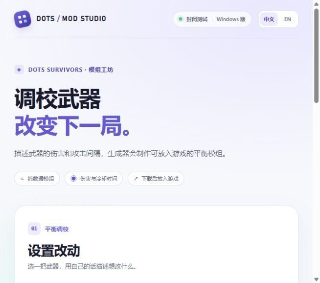
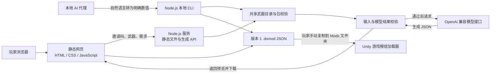

# DOTS Survivors 玩家模组生成器

这是一个面向《DOTS Survivors》Windows 版本封闭测试玩家的网页工具。玩家用自然语言描述武器平衡调整，服务端调用兼容 OpenAI Chat Completions 的模型，校验生成结果并提供 `.dsmod` 文件下载。模组只包含数据，不包含脚本或可执行内容。

## 页面预览

以下截图展示本地中文界面的主要页面：

| 生成器首页 | 编辑需求 | 结果预览 |
| --- | --- | --- |
|  |  |  |

## 功能

- 通过邀请码进入封闭测试界面，支持简体中文和英文。
- 为现有武器的各个等级生成基础伤害、冷却时间调整；黑洞武器仅支持调整冷却时间。
- 生成前在服务端校验武器、等级和数值范围，网页提供结果预览、JSON 复制和 `.dsmod` 下载。
- 按 IP 限制每小时生成次数，并限制全站每日生成次数。
- 模型密钥只由服务端读取；模型接口由环境变量配置。
- 提供本地 CLI 与仓库内 Agent 技能，支持生成、校验、安装 `.dsmod`，并根据 Unity 日志检查是否加载。

## 系统架构



网页服务使用 Node.js 内置模块提供静态文件与 `/api/mods/generate` 接口。本地 CLI 与网页共用武器目录和数据包校验，CLI 还可安装文件并检查 Unity Player 日志。游戏在本地读取 `.dsmod` 文件，加载日志与实际数值验证是两个不同的检查步骤。

## 技术栈

| 部分 | 技术 | 用途 |
| --- | --- | --- |
| 页面 | HTML、CSS、原生 JavaScript | 表单、双语界面、结果预览与文件下载 |
| 服务端 | Node.js 20+、内置 `node:http`、`fetch` | 静态资源、生成接口、模型请求与限流 |
| 本地工具 | Node.js CLI、仓库内 Agent 技能 | 按明确数值生成、校验、安装并检查日志 |
| 模型接口 | OpenAI 兼容的 Chat Completions API | 将玩家描述转换为结构化调整数据 |
| 模组格式 | JSON、`.dsmod` 扩展名 | 与 Unity 加载器共享的数据包契约 |
| 校验 | Node.js 内置测试运行器 | `node --test` 校验等级及数值边界 |

项目没有第三方 npm 运行时依赖，无需执行 `npm install`。

## 本地 Agent 与 CLI

在项目根目录运行 `npm run mod -- catalog` 查看现有武器。下面的命令会创建并自动校验一个只调整圆锯第 1 级的模组：

```powershell
npm run mod -- create --weapon SawBlade --title "Faster Buzz Saw" --id faster-buzz-saw --set "1:damage=28,cooldown=2.4" --out .\faster-buzz-saw.dsmod
```

`npm run mod -- validate .\faster-buzz-saw.dsmod` 可再次校验。安装与日志检查的用法见 [本地 CLI 文档](docs/cli.md)。仓库内的 [Agent 技能](.agents/skills/dots-survivors-local-modder/SKILL.md) 让支持技能的编程代理根据玩家描述调用这些工具。CLI 本身不调用模型，具体改动值由玩家或代理确认。

开发者还可运行 `npm run catalog:check -- "D:\Unity Space\Survivor"`，检查当前武器目录是否与 Unity 的升级资源一致。

## 本地运行

需要 Node.js 20 或更新版本。在项目根目录使用 PowerShell；已有 `.env` 时保留现有文件：

```powershell
if (-not (Test-Path .env)) { Copy-Item .env.example .env }
```

编辑 `.env`，填写测试邀请码、模型 API 密钥和模型名称，然后启动：

```powershell
npm start
```

在浏览器打开 <http://127.0.0.1:4173/>。`npm start` 已在 Node.js v24.18.0 环境验证可启动；访问地址和端口可通过 `HOST`、`PORT` 调整。

| 环境变量 | 默认值 | 说明 |
| --- | --- | --- |
| `HOST` | `127.0.0.1` | HTTP 服务监听地址 |
| `PORT` | `4173` | HTTP 服务端口 |
| `BETA_ACCESS_CODE` | 空 | 封闭测试邀请码；未配置时生成接口不可用 |
| `LLM_PROVIDER` | `openai-compatible` | 模型适配器；支持 `openai-compatible`、`deepseek` |
| `LLM_BASE_URL` | `https://api.openai.com/v1` | 兼容接口的基础地址；示例环境文件配置为 DeepSeek 地址 |
| `LLM_API_KEY` | 空 | 服务端模型 API 密钥 |
| `LLM_MODEL` | 空 | 请求使用的模型名称 |
| `MAX_GENERATIONS_PER_WINDOW` | `4` | 每 IP 滚动一小时生成上限 |
| `MAX_GENERATIONS_PER_DAY` | `20` | 全站每日生成上限，按 UTC 日期计算 |

不要将真实邀请码或 API 密钥提交到 Git。限流计数保存在服务进程内存中，服务重启后会重置。

## 玩家使用与安装

1. 打开测试网站并输入邀请码。
2. 选择武器，用自然语言描述希望调整的等级和数值。
3. 检查预览中的武器、等级与改动，下载 `.dsmod` 文件。
4. 先启动一次游戏，然后将文件复制到 `%USERPROFILE%\AppData\LocalLow\DefaultCompany\Survivor\Mods`，再重启游戏。若公司名或产品名不同，请使用 Unity Player 日志 `[Player Mods]` 消息中显示的目录。

模组在每局开始时加载。网站不会自动安装模组，也没有游戏内模组浏览器或 Steam Workshop 集成。

## `.dsmod` 范围

版本 1 使用 `gameId: "dots-survivors"` 和 `schemaVersion: 1`，通过 `weapons` 和 `levels` 描述现有武器的等级改动。`level` 从 1 开始；未指定的等级与字段保留游戏原值。

| 字段 | 支持范围 |
| --- | --- |
| 基础伤害 | 0–10,000 的整数；黑洞不支持伤害改动 |
| 武器冷却 | 0.1–600 秒 |
| 等级 | 所选武器现有升级等级；当前武器目录为 8 级 |

Unity 加载器也会校验模组。它最多读取 Mods 目录顶层的 50 个文件，每个文件不超过 64 KiB；多个文件修改同一字段时，按文件名不区分大小写排序应用，后应用的值生效。完整格式与加载规则见 Unity 项目 `Assets/DOTSSurvivors/AI/MarkdownDocumentation/integrations/PlayerMods.md`。

## 开发校验

```powershell
npm test
```

该命令运行仓库现有的 Node.js 校验用例（`node --test`）。
